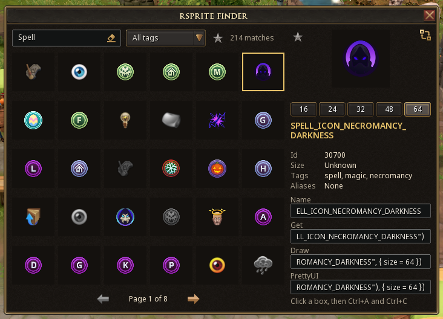

# rsprite

Find and draw any RS3 sprite in one line.

> **Status:** early development. rsprite is not on the Plugin Hub yet. Version 0.1.0 is being tested against game client 950-1.



rsprite is a small Lua library for developers building plugins with the RS3 plugin API. It finds sprites by name or keyword, looks them up safely, and draws sprites and item icons for you, so you don't have to write the same drawing code in every plugin.

It has no dependencies, so you can use it with or without PrettyUI.

## Installing

rsprite is not on the Plugin Hub yet, so for now you install it by hand.

### Get rsprite

Either:

- **Download a release.** Get `rsprite-0.1.0.zip` from the [latest release](https://github.com/sereselene/rsprite/releases) and unzip it into the folder your game client loads development plugins from.
- **Or clone the repository**, then copy the `plugins/rsprite` folder into that same plugins folder. This gives you the latest code on `main` rather than a tested release.

Either way, the `rsprite` folder should sit next to your own plugin's folder.

### Use it in your plugin

Add rsprite to the `requiredDependencies` in your plugin's `plugin.json`, using its folder name:

```json
{
  "requiredDependencies": {
    "rsprite": "rsprite"
  }
}
```

In the game's console, run `prf`, then `prl rsprite`, then load your own plugin.

The client loads rsprite before your plugin and makes it available as the global `rsprite`, so there is nothing to `require`. The global takes its name from the key, so keep the key as `rsprite`.

When rsprite is published on the Plugin Hub, replace `"rsprite"` with its Plugin Hub id. From then on, players who install your plugin get rsprite automatically, and nobody needs to download it by hand.

## Quick example

```lua
local attackId = rsprite.Get("SKILL_ATTACK")

local icon = rsprite.Draw(parent, { "SKILL_NECROMANCY", "BP3_MISSION_ICON_SKILL_NECROMANCY", Plugin.resources.my_icon }, {
    x = 10,
    y = 10,
    size = 24,
})

local ring = rsprite.DrawItem(parent, 13562, { x = 40, y = 10, size = 24 })
```

- `Get` turns a sprite name into its id. Names are not case sensitive.
- `Draw` tries each entry in the list in order and draws the first one that exists. There is no `SKILL_NECROMANCY` sprite, so here it draws the Necromancy mission icon instead. If nothing in the list exists, it draws a grey placeholder square, so missing art is easy to spot.
- `DrawItem` draws an item's icon from its item id.

## API

| Function | What it does |
| --- | --- |
| `rsprite.version` | The library version, such as `"0.1.0"`. |
| `rsprite.Get(name)` | The sprite id for a name, or `nil`. Not case sensitive. Results are cached. |
| `rsprite.Name(id)` | The sprite name for an id, or `nil`. Results are cached. |
| `rsprite.Resolve(nameOrChain)` | The first source in a chain that exists and its position in the chain, or `nil`. |
| `rsprite.Draw(parent, nameOrChain, options)` | Creates a new `ui.Sprite` showing the first source that exists. Returns the sprite and the position used. |
| `rsprite.SetSource(sprite, nameOrChain, options)` | Changes an existing sprite to a new chain, clearing any item icon it showed. Returns the position used. |
| `rsprite.DrawItem(parent, itemId, options)` | Creates a new `ui.Sprite` showing an item's icon. Returns the sprite. |
| `rsprite.SetItem(sprite, itemId, options)` | Shows an item's icon on an existing sprite. Returns `true` if an item is shown, otherwise `false`. |
| `rsprite.Find(text, options)` | Searches sprite names, tags and aliases. Returns the matching entries and the total number of matches. |
| `rsprite.Tags()` | Every tag you can filter by, sorted alphabetically. |
| `rsprite.BuildIndex(onReady)` | Prepares the search index over a few ticks, then calls `onReady` with the number of sprite names. |
| `rsprite.IsIndexReady()` | Whether the search index is ready. |

### Chains

`Draw`, `SetSource` and `Resolve` take either one source or a list of sources, called a chain. Each entry can be:

- a sprite name, such as `"SKILL_ATTACK"`
- a sprite id, such as `9318`
- an image from your own plugin, such as `Plugin.resources.my_icon`

rsprite uses the first entry that exists. A chain is a plain Lua array, so a `nil` entry ends it. Build chains without gaps.

An empty chain draws the placeholder, the same as a chain where nothing exists. Pass `placeholder = false` to draw nothing instead.

### Options

| Option | Used by | Meaning |
| --- | --- | --- |
| `x`, `y` | `Draw`, `DrawItem` | Position inside the parent, in interface units. Any finite number, negatives included. Default 0. |
| `xAnchor`, `yAnchor` | `Draw`, `DrawItem` | The point in the parent that `x` and `y` are measured from, as a fraction of its width and height. 0 is the left or top edge, 0.5 the middle and 1 the right or bottom edge. Any finite number. Default 0. |
| `size` | `Draw`, `DrawItem` | Width and height together, as a finite number above 0. Default 24. |
| `width`, `height` | `Draw`, `DrawItem` | Set each side on its own, overriding `size`. Each must be a finite number above 0. |
| `colour` | `Draw`, `SetSource` | A tint, as a packed `0xRRGGBBAA` number. |
| `alpha` | `Draw`, `SetSource` | Opacity, from 0 to 1. |
| `quantity` | `DrawItem`, `SetItem` | A stack number shown on the item, as a whole number 0 or above. |
| `placeholder` | `Draw`, `SetSource`, `DrawItem`, `SetItem` | Whether to draw the grey placeholder when nothing exists. Default `true`. |

An unknown option, or a value that breaks these rules, raises an error. See Errors and warnings.

### Items

For items, `nil` means no item. `DrawItem(parent, nil)` creates an empty, hidden sprite, and `SetItem(sprite, nil)` clears the icon, hides the sprite and returns `false`. Neither shows the placeholder or prints a warning, so empty slots and reused rows stay quiet.

Any other id that isn't a whole number 0 or above prints one warning and shows the placeholder, unless `placeholder` is `false`.

rsprite can't tell whether an item has an icon, so a valid item id without one draws nothing.

`SetSource` and `SetItem` can swap one sprite between an item icon and a sprite, so a single slot can show either.

### Search

`Find(text, options)` matches every word you type against sprite names, tags and aliases. Spaces, hyphens and underscores count as the same thing, and case doesn't matter.

Its options are `tags` (a list of tag names to filter by), `limit` (default 50) and `offset`, for paging through results. Each entry looks like `{ name, id, tags, aliases, width, height }`. `width` and `height` are only there when the size is known.

Results are ordered like this:

1. exact names and exact aliases
2. names or aliases that start with your search
3. tag matches
4. everything else

Within each group, sprites from the curated list come first, then shorter names.

An empty search lists every sprite, curated sprites first, then the rest by id. Tags, `limit` and `offset` still apply, so `rsprite.Find("", { tags = { "skill" } })` lists every skill sprite a page at a time. `rsprite.Tags()` gives you the tag names, ready for a filter dropdown.

The first search takes a moment while rsprite reads the sprite names. To spread that over a few ticks instead, call `rsprite.BuildIndex()` when your plugin starts.

### Errors and warnings

Anything rsprite can't find comes back as `nil`, so `if spriteId then` is all the checking you need. rsprite also prints one `rsprite:` warning for each missing name, so typos show up in the console.

Mistakes in how you call rsprite raise an error that points at your own line. That includes a `nil` parent, a table where a component belongs, a name for `Get` that isn't a string, an id for `Name` that isn't a number, an unknown option, an option of the wrong type, a size of 0 or below, a position, anchor or size that isn't a finite number, and a quantity that isn't a whole number 0 or above. For a table, the error reminds you to pass the component itself, such as a window's content. Passing `nil` to `Get` or `Name` isn't a mistake: it gives `nil`, with no warning. Problems at runtime, such as a sprite that doesn't exist, never raise.

If the function you pass to `BuildIndex` raises an error, rsprite prints one warning with the error, skips that function from then on, and still finishes the index.

### Notes

- rsprite always draws at a set size, 24 by 24 unless you choose another. `Find` reports a sprite's real size when it's known, either from its name (`_32PX` means 32 by 32) or from the curated list.
- Sprite names come from the game you're running, so they always match the current game build.
- If you inspect a sprite drawn by `Draw` or `SetSource`, the source it used is held in its `sprite` property.

## The finder

rsprite comes with a separate plugin, `rsprite-finder`, for finding sprites while you build. Players never need it, so never list it as a dependency. To install it, unzip `rsprite-finder-0.1.0.zip` from the same release next to the `rsprite` folder, or copy `plugins/rsprite-finder` from a clone, then run `prl rsprite-finder` in the game's console. It needs rsprite and PrettyUI enabled.

Open the Plugin Hub's Manage list, click the finder's settings cog, and press **OPEN FINDER**. The window has:

- **A search box.** Type a few words, such as `arrow`, `skill attack` or `necromancy`. Results update when you stop typing. The clear button at the end of the box empties it.
- **A tag dropdown**, to narrow the results to buttons, icons, skills and so on.
- **A favourites star** next to the dropdown. Turn it on to show only the sprites you've starred, newest first. The search box and tag dropdown still apply.
- **A grid of previews**, 30 per page, with arrows to move between pages. Hover over a preview to see its full name.
- **A detail panel** for the sprite you select. It shows a larger preview at 16, 24, 32, 48 or 64 px, the sprite's id, its size when known, and its tags and aliases.

Around the large preview:

- **The star** in the top left adds the sprite to your favourites or removes it.
- **The swap button** in the top right changes the preview background between dark, light and a checkerboard, which helps with dark or transparent sprites. It only affects the large preview.
- **The arrows** either side step through a sprite's numbered variants, when it has any.

Below the details are four boxes you can copy from:

- **Name**: the sprite name.
- **Get**: `rsprite.Get("NAME")`.
- **Draw**: `rsprite.Draw(parent, "NAME", { size = N })`, where N is the selected preview size.
- **PrettyUI**: `window:AddSprite(rsprite.Get("NAME"), { size = N })`, for adding the sprite to a PrettyUI window.

Click a box, then press Ctrl+A and Ctrl+C to copy it. Long values may only show their end in the box, but the whole value is copied. If you type in a box by accident, it puts its text back.

The finder's settings cog has two options, both on by default. Changes apply to an open finder straight away.

- **Group numbered variants** shows sprites that differ only by a number at the end, such as `ATTACKING_RETICULE_FRAME_1` to `_3`, as one tile. Hover over the tile to see how many variants it has, and use the arrows beside the preview to step through them. The details and copy boxes follow the variant you're on.
- **Hide mobile and language copies** hides sprites with `_MOBILE` in their name, and French, German, Portuguese and Spanish copies whose names end in `_FR`, `_DE`, `_PT` or `_ES`, with or without a number after them. English copies stay.

Favourites always show exactly what you starred, whatever the options are set to, including the exact variant. If a game update removes a sprite you starred, it's hidden but kept in your list in case it returns.

The finder remembers your search, tag, page, selection, preview size, preview background, favourites and options between sessions. The first time you open it, it takes a moment to read the sprite names before the grid fills in.

The finder prints its own warnings with the `rsprite-finder:` prefix.

## Using rsprite with PrettyUI

rsprite doesn't replace PrettyUI's components. It finds the right sprite for them. `Resolve` returns whichever source in the chain exists, which you can pass straight to PrettyUI:

```lua
local close = rsprite.Resolve({ "CLOSE_BUTTONS_0", Plugin.resources.close_fallback })
prettyui.Sprite.new(parent, close, { size = 16 })
```

This works anywhere PrettyUI accepts a sprite id or an image, including `SimpleButton` and `BuffBar`.

## Working on rsprite

You need Node 22.12 or later. StyLua and lefthook install platform specific binaries, so if you work from both Windows and WSL, run `npm install` once on each side. Don't run `npm ci` locally, because it removes the other side's binaries. `npm run check-platform` tells you if the current side is missing anything.

| Command | What it does |
| --- | --- |
| `npm test` | Runs the Lua selftests, then the script tests. |
| `npm run format` | Formats every Lua file with StyLua. |
| `npm run catalogue` | Rebuilds the generated module from the committed sprite list after a tag or alias change. |
| `npm run catalogue -- --dump <path> --client <build>` | Rebuilds the whole catalogue from a new game build's sprite name list. |
| `npm run catalogue -- --check` | Fails if the generated catalogue files are out of date. |
| `npm run placeholder` | Regenerates the placeholder image. |
| `npm run finder-images` | Regenerates the finder's images: the text box background and the preview checkerboard. |
| `npm run dev-install -- --target <folder>` | Copies rsprite, the finder and the example plugin into the game's dev plugin folder. |
| `npm run package` | Builds `rsprite-X.Y.Z.zip` and `rsprite-finder-X.Y.Z.zip` in `release`, using each `plugin.json` version. |
| `npm run validate-tag -- v0.1.0` | Checks a release tag against each `plugin.json`, `rsprite.version` and the changelog. |

`dev-install` can also read the target folder from the `RSPRITE_DEV_PLUGIN_FOLDER` environment variable. It only replaces its own `rsprite`, `rsprite-finder` and `rsprite-example` folders and won't touch anything else. After installing, run `prf` in the game's console, then `prl rsprite`, `prl rsprite-finder` and `prl rsprite-example`. Open the example's settings cog to see each feature drawn, or the finder's cog to start searching.

Raw sprite name lists are never stored in this repository. Keep them alongside it, for example in `../sprite-dumps/950-1.txt`, and pass one to `--dump` when a new game build comes out.

The git hooks call Luacheck and gitlint by name, so install both wherever you commit from.

## Releasing

Both plugins in this repository are released together on the same version. To release 0.1.1, for example:

1. In `CHANGELOG.md`, change the heading `## [0.1.1] - Unreleased` to the day you tag, such as `## [0.1.1] - 2026-10-20`. A tag is refused while its heading still says `Unreleased`.
2. Set the version to `0.1.1` in `plugins/rsprite/plugin.json`, `plugins/rsprite-finder/plugin.json` and `rsprite.version` in `plugins/rsprite/src/app/init.lua`.
3. Commit the change and push it to `main` through a pull request.
4. Tag that commit on `main` and push the tag with `git push origin v0.1.1`.
5. Wait for the Release workflow on the Actions tab. It checks the tag with `validate-tag`, runs the tests and the catalogue check, builds both zips with `npm run package`, and creates a draft release with the notes from this changelog.
6. Review the draft, its notes and both zips, then publish it. While the major version is 0, it is marked as a prerelease.

The `pre-push` hook also runs `validate-tag` when you push a tag, so most mistakes show up before the tag leaves your machine. The workflow checks every tag either way, and never publishes a release by itself.

<details open>
<summary><h2>Contributing</h2></summary>

Tags and aliases make search work well, and adding more is the easiest way to help. They live in two files.

`catalogue/tag-rules.json` tags every sprite whose name starts with (`prefix`), contains (`contains`) or ends with (`suffix`) some text:

```json
{ "prefix": "PRAYER_", "tags": ["prayer"] }
```

`catalogue/curated.json` gives a single sprite its own aliases, and optionally tags and a known `width` and `height`. Curated sprites also appear near the top of search results:

```json
"SKILL_ATTACK": { "aliases": ["attack"] }
```

To make a change:

1. Edit either file.
2. Run `npm run catalogue`. It rebuilds the generated module and checks that every curated name exists and every rule matches at least one sprite.
3. Run `npm test`.
4. Open a pull request and fill in its template.

You can also suggest tags or aliases with the suggestion form on [the issue tracker](https://github.com/sereselene/rsprite/issues), or report a problem with the bug report form.

</details>

## Licence

MIT. See the [licence](LICENSE).