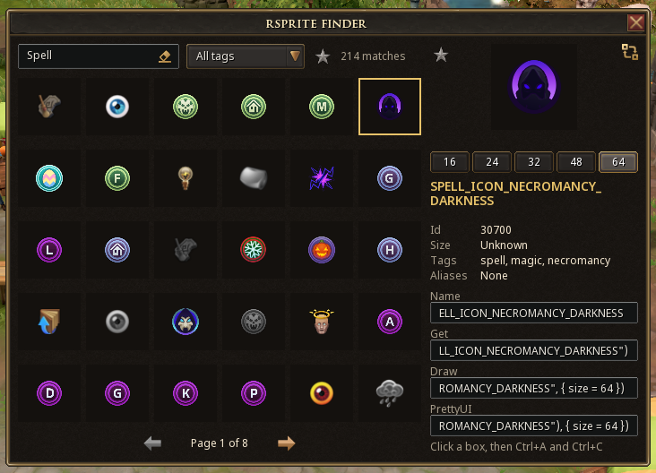

# rsprite

Find and draw RS3 game sprites by name in your own plugins.

> **Status:** early development. Not yet on the Plugin Hub. Tested against game client `950-1`.



## What it does

- **Sprites by name.** Ask for `SKILL_ATTACK` instead of remembering an id.
- **Fallbacks.** Give a list of sprites and the first one that exists is drawn. If none exist, a grey placeholder is drawn instead of a blank gap.
- **Item icons.** Draw any item icon from its item id.
- **Search.** Search every sprite in the game by name, tag or alias.
- **Crash safe.** Sprites known to crash the game client are never drawn.

rsprite has no dependencies of its own and works with or without PrettyUI.

## Quick start

**1. Install.** Download the `rsprite` zip from the [latest release](https://github.com/sereselene/rsprite/releases) and unzip it into the client's development plugins folder.

**2. Add the dependency** to your plugin's `plugin.json`:

```json
{
  "requiredDependencies": {
    "rsprite": "rsprite"
  }
}
```

**3. Load it.** In the game console, run `prf`, then `prl rsprite`, then load your plugin.

**4. Use it.** rsprite is ready to use as `rsprite`, with no `require` needed:

```lua
local attackId = rsprite.Get("SKILL_ATTACK")

local icon = rsprite.Draw(parent, { "SKILL_NECROMANCY", "BP3_MISSION_ICON_SKILL_NECROMANCY" }, {
    x = 10,
    y = 10,
    size = 24,
})

local ring = rsprite.DrawItem(parent, 13562, { x = 40, y = 10, size = 24 })
```

- `Get` turns a name into an id.
- `Draw` draws the first sprite in the list that exists. `SKILL_NECROMANCY` doesn't exist, so the mission icon is drawn.
- `DrawItem` draws an item icon.

Once rsprite is on the Plugin Hub, swap `"rsprite"` in step 2 for its Plugin Hub id, and players get it installed automatically.

## Good to know

- Sprites are 24 by 24 unless you pass a `size`, or a `width` and `height`.
- A fallback list can mix sprite names, sprite ids and your own images such as `Plugin.resources.my_icon`. It must not contain `nil`.
- A missing sprite gives `nil` and logs one warning per name. A wrong argument raises an error at your own line.
- Call `rsprite.BuildIndex()` at startup if you use search, so the first search doesn't have to build the index itself.

Every function and option is listed in the [API reference](docs/API.md).

## Using rsprite with PrettyUI

Pass the result of `Resolve` to any PrettyUI component that takes a sprite, such as `Sprite`, `SimpleButton` or `BuffBar`:

```lua
local close = rsprite.Resolve({ "CLOSE_BUTTONS_0", Plugin.resources.close_fallback })
prettyui.Sprite.new(parent, close, { size = 16 })
```

## Finder

`rsprite-finder` is a separate tool for browsing every sprite while you build. It needs rsprite and PrettyUI. It's for your own use, so don't list it as a dependency.

Install it from the same release, run `prl rsprite-finder`, then open it from its settings cog in the Plugin Hub's Manage list with **OPEN FINDER**.

- Search by name, tag or alias, filter by tag, and star favourites.
- Preview any sprite at 16 to 64 px on a dark, light or checkerboard background.
- Copy its name, or a ready to paste `Get`, `Draw` or PrettyUI snippet.

If the game closes while the finder is drawing, those sprites are hidden next time. **Show hidden sprites again** on the settings cog brings them back.

## Feedback

Report a bug, a sprite that crashes the game client, or suggest a tag or alias on the [issue tracker](https://github.com/sereselene/rsprite/issues).

## Licence

PolyForm Strict 1.0.0. See the [licence](https://github.com/sereselene/rsprite/blob/main/LICENSE).

You can install rsprite and use it from your own plugins through the Plugin Hub dependency. You can't copy, change or republish the code, or build new works from it. It's for noncommercial use only: free plugins that accept donations are fine, paid or paywalled plugins are not.

Using this code to train AI models, or as input to AI tools that produce derivative code, is not permitted.

Versions up to and including 0.1.1 were released under the MIT licence.
